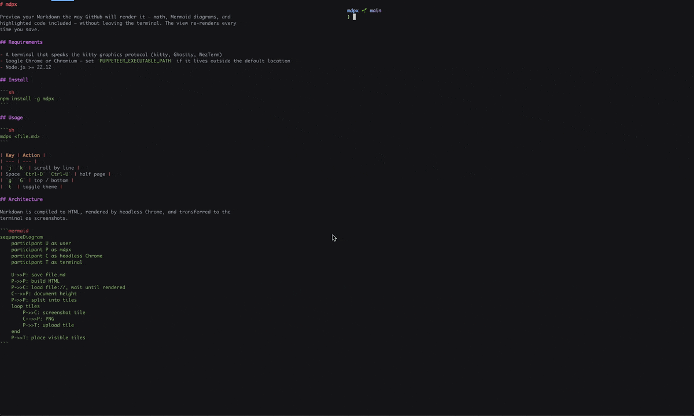
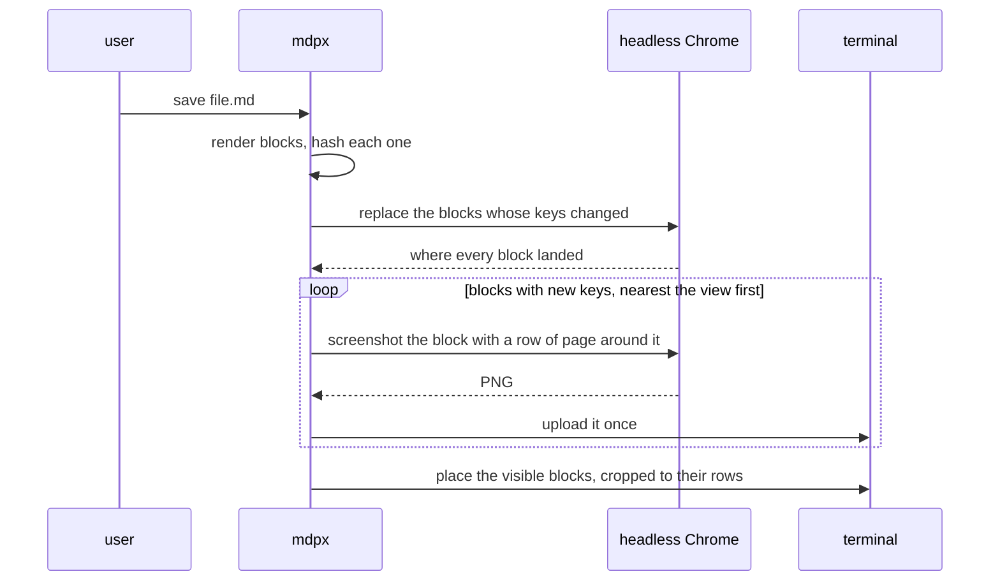

# mdpx

Preview your Markdown the way GitHub will render it — math, Mermaid diagrams, and
highlighted code included — without leaving the terminal. The view re-renders every
time you save.



## Requirements

- A terminal that speaks the kitty graphics protocol (kitty, Ghostty, WezTerm)
- Google Chrome or Chromium — set `PUPPETEER_EXECUTABLE_PATH` if it lives outside the default location
- Node.js >= 24

## Install

```sh
npm install -g mdpx-cli
```

## Usage

```sh
mdpx <file.md>
```

| Key | Action |
| --- | --- |
| Space `Ctrl-D` `Ctrl-U` | half page |
| `g` `G` | top / bottom (`G` follows the end as the file grows) |
| `t` | toggle theme |

Blocks that changed in the last save are marked in the left column for a moment,
and text added above the view does not move what you are reading.

## Architecture

Markdown is compiled to HTML one top-level block at a time, and each block is keyed by
a hash of its rendered HTML. One headless Chrome page stays open for the whole session:
a save patches only the blocks whose keys changed, and only those are captured and sent
to the terminal. Every other block keeps the image the terminal already has, wherever
it moves to.


